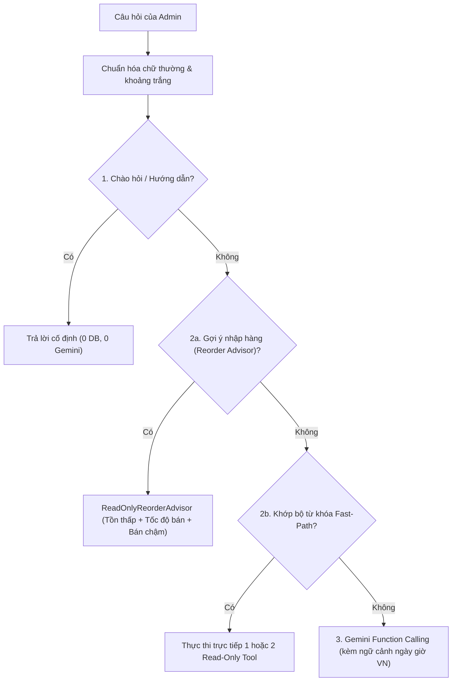

# Tài Liệu Tham Chiếu Bộ Từ Khóa AI Fast-Path (RetailOps V1.0)

Tài liệu này tổng hợp các kịch bản, nhóm từ khóa (hỗ trợ cả tiếng Việt **có dấu** và **không dấu**), quy tắc trích xuất thời gian/số lượng và chốt chặn an toàn trong [`backend/app/modules/ai/orchestrator.py`](../../backend/app/modules/ai/orchestrator.py).

> **Lưu ý:** Toàn bộ các kịch bản khớp Fast-Path dưới đây đều chạy trực tiếp qua `AIToolExecutor` (Read-only, kiểm tra quyền `ADMIN`), phản hồi tức thì (< 50ms) và **tiêu tốn 0 token Gemini**.

---

## 1. Thứ Tự Ưu Tiên Định Tuyến (Routing Pipeline)

---

## 2. Chi Tiết Các Nhóm Tình Huống & Từ Khóa

### 2.1. Nhóm Chào Hỏi & Hướng Dẫn (Khớp chính xác)
| Tình huống | Từ khóa được nhận diện | Phản hồi |
|---|---|---|
| **Chào hỏi** | `xin chào`, `chào`, `chào bạn`, `chào ai`, `hello`, `hi`, `hey` | Lời chào + giới thiệu 4 nhóm tra cứu |
| **Hướng dẫn** | `help`, `hướng dẫn`, `bạn làm được gì`, `bạn có thể làm gì` | Mô tả 4 nhóm dữ liệu thực tế hỗ trợ |

---

### 2.2. Nhóm Tư Vấn Nhập Hàng (`ReadOnlyReorderAdvisor`)
Kết hợp 3 nguồn: **Tồn kho thấp** + **Tốc độ bán trong kỳ** + **Cảnh báo hàng bán chậm (`SLOW_MOVING_HOLD`)**.

- **Từ khóa kích hoạt**:
  - `gợi ý nhập hàng`, `gợi ý nhập`, `đề xuất nhập hàng`, `tư vấn nhập hàng`
  - `nên nhập hàng`, `nên nhập thêm`, `nên nhập kho`, `nên đặt thêm`
  - `nhập hàng gì`, `nhập thêm gì`, `nhập kho gì`, `nhập gì`, `cần nhập gì`
  - `sản phẩm cần nhập`, `sản phẩm nào cần nhập`, `sản phẩm cần nhập thêm`, `sản phẩm nên nhập`, `mặt hàng cần nhập`, `hàng cần nhập`
  - `cần nhập thêm`, `cần nhập hàng`, `cần nhập kho`, `cần nhập`, `nhập thêm`
  - `bổ sung hàng`, `bổ sung kho`, `cần bổ sung`, `đặt hàng thêm`, `cần đặt thêm`, `reorder advisor`, `restock`
- **Từ khóa loại trừ (không kích hoạt Reorder Advisor)**:
  - Phủ định: `không cần`, `không muốn`, `đừng`, `không phải`, `chưa cần`, `khỏi cần`
  - Hỏi lý thuyết/công thức (chuyển sang Gemini giải thích): `giải thích`, `nguyên tắc`, `công thức`, `là gì`, `cách tính`, `hoạt động như thế nào`
- **Khung thời gian phân tích**: Mặc định `7 ngày`, hỗ trợ tùy chỉnh `N ngày` hoặc `N tuần` (trong khoảng `1..90 ngày`).

---

### 2.3. Nhóm Tổng Quan & Kết Hợp (`get_sales_summary` + `get_top_products`)
Trả đồng thời **báo cáo doanh thu** và **top sản phẩm bán chạy** trong cùng kỳ.

- **Tình huống kích hoạt**:
  1. Câu hỏi chứa **Từ khóa tổng quan**: `tình hình bán hàng`, `tình hình kinh doanh`, `báo cáo bán hàng`, `tổng quan cửa hàng`, `tổng quan bán hàng`.
  2. Câu hỏi chứa đồng thời **Từ khóa doanh thu** + **Từ khóa sản phẩm / bán chạy** (ví dụ: *"Doanh thu và sản phẩm 7 ngày gần nhất"*, *"Doanh thu và top 3 sản phẩm bán chạy nhất 1 tháng qua"*).

---

### 2.4. Nhóm Doanh Thu, Đơn Hàng & AOV (`get_sales_summary`)
- **Từ khóa kích hoạt**:
  - `doanh thu`, `doanh số`
  - `số đơn`, `tổng đơn`, `đơn hoàn thành`, `đơn hoàn tất`, `đơn hủy`
  - `giá trị đơn trung bình`, `aov`
- **Ví dụ câu hỏi**:
  - *"Doanh thu hôm nay"*, *"Xem doanh thu"* (mặc định ngày hôm nay theo giờ VN)
  - *"Doanh thu hôm qua"*, *"Doanh số tuần trước"*, *"Doanh thu tháng trước"*
  - *"Doanh thu 7 ngày gần nhất"*, *"Số đơn hàng hôm nay"*, *"Doanh thu từ 2026-11-01 đến 2026-11-15"*

---

### 2.5. Nhóm Sản Phẩm Bán Chạy / Doanh Thu Cao (`get_top_products`)
- **Từ khóa & Mẫu câu kích hoạt**:
  - Từ khóa bán chạy: `bán chạy`, `chạy nhất`, `bán nhiều nhất`, `bán được nhiều nhất`, `bán tốt nhất`, `bán mạnh`, `tiêu thụ nhiều nhất`, `tiêu thụ mạnh nhất`, `mua nhiều nhất`, `đặt nhiều nhất`, `đắt khách nhất`, `hot nhất`, `best seller`, `bestseller`, `top bán chạy`, `top sản phẩm`, `top mặt hàng`
  - Từ khóa doanh thu theo sản phẩm: `sản phẩm/mặt hàng` + `doanh thu cao nhất`, `doanh thu nhiều nhất`, `doanh thu lớn nhất`, `doanh số cao nhất`
  - Mẫu `Top N`: `top <N> sản phẩm / mặt hàng / sp ...` (khi không đi kèm từ khóa bán chậm hoặc tồn thấp)
- **Ví dụ câu hỏi**:
  - *"Top 5 sản phẩm trong 2 tuần"*, *"Top 3 sản phẩm bán chạy nhất trong 1 tháng"*
  - *"3 sản phẩm bán chạy nhất 14 ngày gần nhất"*, *"Mặt hàng nào chạy nhất?"*
  - *"Top 3 sản phẩm doanh thu cao nhất tháng này"*

---

### 2.6. Nhóm Sản Phẩm Bán Chậm (`get_slow_products`)
Áp dụng quy tắc nghiệp vụ cố định: bán `<= 2 SP / 30 ngày` và đã nhập kho `> 7 ngày`.

- **Từ khóa kích hoạt**:
  - `bán chậm`, `bán ế`, `ế ẩm`, `ế nhất`, `hàng ế`, `hàng chậm`, `chậm nhất`
  - `bán ít nhất`, `ít bán nhất`, `bán kém nhất`, `ít người mua nhất`
  - `khó bán`, `không bán được`, `chưa bán được`
  - `tồn kho lâu`, `tồn lâu nhất`, `hàng tồn lâu`, `tồn đọng`
- **Ví dụ câu hỏi**: *"Sản phẩm nào bán ế nhất?"*, *"Top 5 sản phẩm bán chậm nhất"*, *"Hàng tồn đọng"*.

---

### 2.7. Nhóm Sản Phẩm Tồn Kho Thấp (`get_low_stock`)
- **Từ khóa kích hoạt**:
  - `tồn kho thấp`, `tồn thấp`, `tồn kho ít nhất`, `tồn ít nhất`, `còn ít nhất`
  - `sắp hết hàng`, `hàng sắp hết`, `sắp hết`, `gần hết`, `hết hàng`, `cạn kho`, `thiếu hàng`, `hết tồn`
  - `dưới ngưỡng tồn`, `tồn kho dưới ngưỡng`, `cảnh báo tồn kho`
- **Ví dụ câu hỏi**: *"Sản phẩm nào sắp hết?"*, *"Top 5 sản phẩm tồn kho thấp nhất"*, *"Cảnh báo tồn kho"*.

---

## 3. Quy Tắc Trích Xuất Thời Gian & Số Lượng (`Top N`)

### 3.1. Bảng Quy Đổi Đơn Vị Thời Gian (Múi giờ `Asia/Ho_Chi_Minh`)
| Cụm từ thời gian trong câu hỏi | Công thức quy đổi | Công cụ áp dụng |
|---|---|---|
| Không nêu thời gian | Doanh thu: `Hôm nay` / Top SP & Reorder: `7 ngày` | Tất cả |
| `hôm nay` | `1 ngày` (`today`) | Doanh thu, Top SP, Tổng quan |
| `hôm qua` | Ngày `today - 1` | Doanh thu, Tổng quan |
| `N ngày` (`1..90`) | `N` ngày gần nhất tính đến hôm nay | Doanh thu, Top SP, Tổng quan, Reorder |
| `N tuần` (`1..12`) | `N * 7` ngày gần nhất | Doanh thu, Top SP, Tổng quan, Reorder |
| `N tháng` (`1..3`) | `N * 30` ngày gần nhất | Doanh thu, Top SP, Tổng quan |
| `nửa tháng` | `15` ngày gần nhất | Doanh thu, Top SP, Tổng quan |
| `tuần này` | Từ Thứ Hai tuần hiện tại đến hôm nay (`weekday + 1` ngày) | Doanh thu, Top SP, Tổng quan |
| `tuần qua` / `tuần vừa qua` / `tuần gần nhất` | `7` ngày gần nhất | Doanh thu, Top SP, Tổng quan |
| `tháng này` | Từ ngày `01` tháng hiện tại đến hôm nay (`today.day` ngày) | Doanh thu, Top SP, Tổng quan |
| `tháng qua` / `tháng vừa qua` / `tháng gần nhất` | `30` ngày gần nhất | Doanh thu, Top SP, Tổng quan |
| `tuần trước` | Thứ Hai → Chủ Nhật của tuần lịch trước | Chỉ áp dụng `get_sales_summary` |
| `tháng trước` | Ngày đầu → Ngày cuối của tháng lịch trước | Chỉ áp dụng `get_sales_summary` |
| `từ YYYY-MM-DD đến YYYY-MM-DD` | Khoảng ngày cố định | Chỉ áp dụng `get_sales_summary` |

### 3.2. Quy Tắc Trích Xuất Số Lượng (`limit`)
- Hỗ trợ 2 mẫu:
  1. `top <N>` hoặc `top<N>` (ví dụ: `"top 3"`, `"top10"`)
  2. `<N> sản phẩm / mặt hàng / sp` (ví dụ: `"3 sản phẩm bán chạy nhất"`, `"5 mặt hàng tồn ít nhất"`)
- **Giới hạn hợp lệ**: `1 <= N <= 20` (mặc định `5` cho Top SP, `10` cho Bán chậm & Tồn kho thấp).

---

## 4. Các Chốt Chặn An Toàn (Fail-Closed Guards)

Để tránh trả lời sai ngữ cảnh khi người dùng hỏi vượt phạm vi của 4 tool tổng hợp, Fast-Path sẽ **tự động từ chối khớp** (nhường cho tầng kiểm tra lỗi hoặc Gemini xử lý) trong các trường hợp:

1. **Vượt ngưỡng Contract**:
   - Khoảng thời gian `< 1` hoặc `> 90 ngày` (ví dụ: *"100 ngày"*, *"20 tuần"*, *"6 tháng"*, *"quý này"*, *"năm nay"*).
   - Số lượng sản phẩm `limit > 20` (ví dụ: *"top 50 sản phẩm"*).
2. **Mốc lịch cụ thể cần phân giải phức tạp**:
   - Ngày dạng `DD/MM` (ví dụ: *"18/11"*) hoặc tháng lịch cụ thể `tháng <1..12>` (ví dụ: *"doanh thu tháng 10"*).
3. **Câu hỏi phân tích chi tiết theo từng ngày/đơn, so sánh hoặc giải thích lý thuyết/phủ định**:
   - Câu hỏi doanh thu chứa: `cao nhất`, `thấp nhất`, `lớn nhất`, `nhiều nhất`, `ít nhất` mà không gắn với sản phẩm (ví dụ: *"Ngày nào doanh thu cao nhất tuần này?"*).
   - Câu hỏi chứa: `so sánh`, `theo ngày`, `từng ngày`, `biểu đồ`, `xu hướng`, `tăng trưởng`, `đơn nào`, `chi tiết đơn`.
   - Câu hỏi yêu cầu giải thích định nghĩa/công thức (`giải thích`, `nguyên tắc`, `công thức`, `là gì`, `cách tính`, `hoạt động như thế nào`) hoặc câu phức có mệnh đề phủ định (`không cần`, `không muốn`, `đừng`, `chưa cần`).
